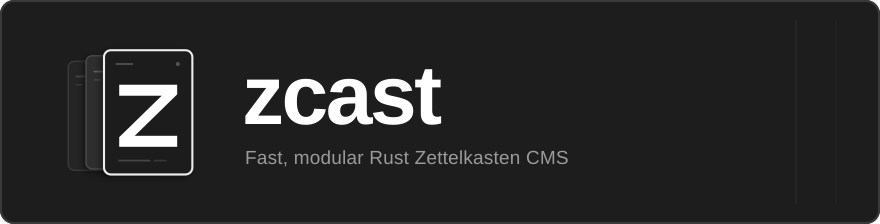

<p align="center">
  
</p>

**zcast** is a fast, self-hosted, single-author Zettelkasten CMS built on a contract-oriented Rust microkernel.

### Repositories

| Repository | Description |
|------------|-------------|
| [`zcast`](https://github.com/zcast-cms/zcast) | Microkernel, CLI, installer/updater, documentation, and bundled first-party modules |
| [`zcast-interfaces`](https://github.com/zcast-cms/zcast-interfaces) | Versioned Rust trait contracts and the minimal `Note` primitive |
| [`zcast-theme-davidhewitson`](https://github.com/zcast-cms/zcast-theme-davidhewitson) | Editorial dark/light/auto sliding-panes theme inspired by `davidhewitson.co.uk` |

### Quick Install

```bash
curl -sSL https://raw.githubusercontent.com/zcast-cms/zcast/main/installer/install.sh | sh
```
